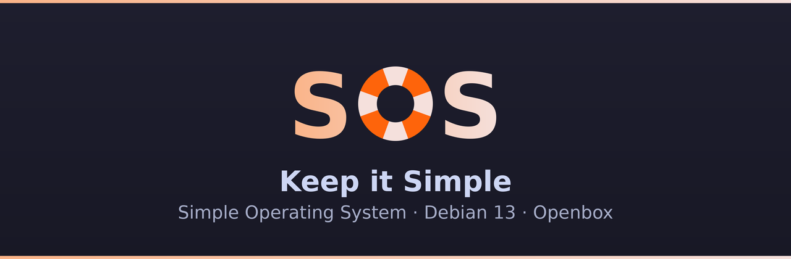
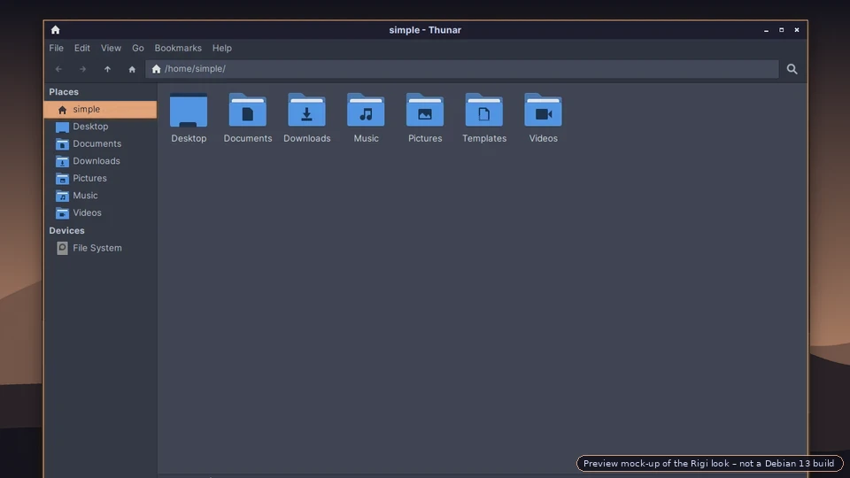
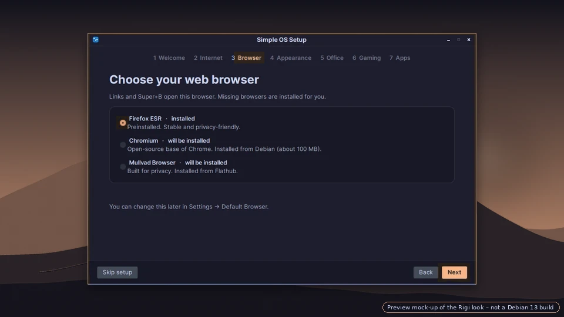
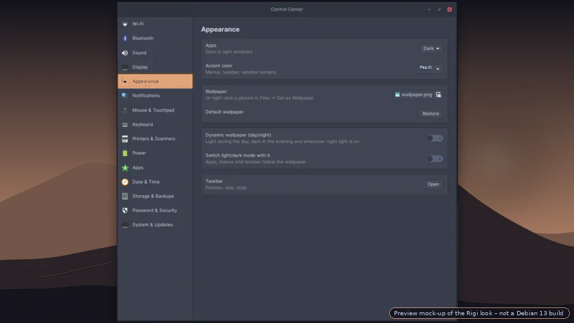
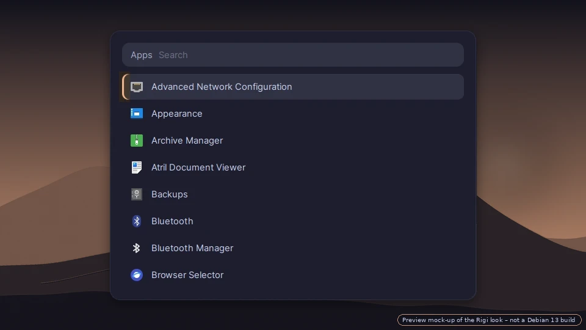

# Simple OS

**A fast, calm Linux desktop based on Debian 12. It sets itself up, updates itself, and you never need a terminal.**

  <a href="https://github.com/FreakySneaky787/Simple-OS/releases/latest"><b>⬇ Download Simple OS (latest release, about 1.5 GB)</b></a>
  &nbsp;·&nbsp; <a href="RELEASE_NOTES.md#known-issues">Known issues</a>
  &nbsp;·&nbsp; <a href="https://github.com/FreakySneaky787/Simple-OS/discussions">Questions</a>
  &nbsp;·&nbsp; <a href="https://github.com/FreakySneaky787/Simple-OS/issues/new/choose">Report a bug</a>

| | |
|---|---|
|  The desktop |  Setup Wizard on the first login |
|  Control Center |  App menu |

## System requirements

- 64-bit PC (x86-64) with **UEFI or legacy BIOS**. **Secure Boot is supported**, so you can leave it on.
- 2 GB RAM (1 GB minimum for the installer, 4 GB or more recommended for browsing and gaming)
- 20 GB disk space (the installer accepts 10 GB)
- Internet for the setup wizard (browser, office suite, games) and for updates

Which computers Simple OS is known to work on, what didn't work, and how to add yours:
[hardware compatibility](docs/HARDWARE.md).

## Install

1. **Download** `Simple-OS.iso` and `Simple-OS.iso.sha256` from the [latest release](https://github.com/FreakySneaky787/Simple-OS/releases/latest).
2. **Check the download** (optional, recommended):
   - Linux: `sha256sum -c Simple-OS.iso.sha256` should print `Simple-OS.iso: OK`
   - Windows (PowerShell): `Get-FileHash Simple-OS.iso` and compare the hash with the one in `Simple-OS.iso.sha256`
3. **Make a USB stick** (4 GB or larger, everything on it is erased):
   - Windows / macOS / Linux: [balenaEtcher](https://etcher.balena.io) – pick the ISO, pick the stick, Flash.
   - Windows: [Rufus](https://rufus.ie) also works. If it asks, choose **"Write in DD Image mode"**.
   - Linux: *Disks* (gnome-disks) → select the stick → *Restore Disk Image…*, or
     `sudo dd if=Simple-OS.iso of=/dev/sdX bs=4M status=progress oflag=sync` (replace `sdX` with the stick – check with `lsblk`!)
4. **Start from the stick.** Usually F12, F9, F2 or Esc right after power-on, depending on the brand. The live
   session needs no password. If something unexpected asks: user `simple`, password `live`.
5. **Install** with **Install Simple OS** on the desktop.

Already running Simple OS? New versions arrive through **Software Updates** – no need to reinstall.

## Testing Simple OS

Thank you for testing! Every report helps, especially from real hardware.

**Wanted right now** (1.2 is out):

- **German or French:** set Deutsch or Français in Control Center → Language & Region (or install in that language).
  Is anything of Simple OS still English – a window, a menu, a message, a password prompt? Does a French text sound
  wrong? The French translation is new and not yet checked by a native speaker.
- **Users:** add a second account in Control Center → Users, sign in with it, switch between both (power menu →
  Switch user). Does the picture show on the login screen?
- **Windows programs:** double-click a downloaded `.exe`. Does SOS Bridge install and open it? Which programs work?
- **Setup Wizard → Extras:** turn on Gaming Support or Developer Tools – do they install cleanly?
- **The search:** leave the mouse pointer in the middle of the screen, press Super, type "display settings" and
  Enter – does the Display page open?
- **Updating from 1.1.2 or older** through Software Updates, and **installing on real hardware** (BIOS and UEFI, also next to
  Windows).

**How to report:**

1. Open **Menu → Help → Report a Problem**. It saves a report file to your Desktop (your name, user name, network
   names and addresses are removed).
2. Open a [bug report](https://github.com/FreakySneaky787/Simple-OS/issues/new/choose), fill in the form and drag the
   report file into it.
3. Useful extra logs, if something went wrong:
   - errors of the current start: `journalctl -b -p err`
   - errors of the previous start (e.g. after a hang at shutdown): `journalctl -b -1 -p err`
   - an install that did not finish (still in the live session): `sudo cat /root/.cache/calamares/session.log`

Not sure if it's a bug, or a question like "does it run on my PC?" – ask in [Discussions](https://github.com/FreakySneaky787/Simple-OS/discussions).

## Thanks

Thanks to all Testers & Users <3

Every test on real hardware, every bug report and every idea makes Simple OS better.

## Documentation

- [Hardware compatibility](docs/HARDWARE.md) – which computers Simple OS runs on, and how to add yours
- [Release notes](RELEASE_NOTES.md) – what is new, known issues
- [Roadmap](ROADMAP.md) – what comes next (1.2, 2.0 on Debian 13)
- [Contributing](CONTRIBUTING.md) – reporting bugs, ideas, pull requests
- [For developers](docs/DEVELOPING.md) – building the ISO, updates and one-time steps, how we work, the structure
- [The tools](docs/TOOLS.md) – what each of Simple OS's own tools does
- [Maintaining](docs/MAINTAINING.md) – releasing a new version · [Testing checklist](TESTING.md) · [Security](SECURITY.md)

## License

Simple OS's own files are licensed under the [GPL-3.0](LICENSE); the Debian packages in the image keep their own licenses.
