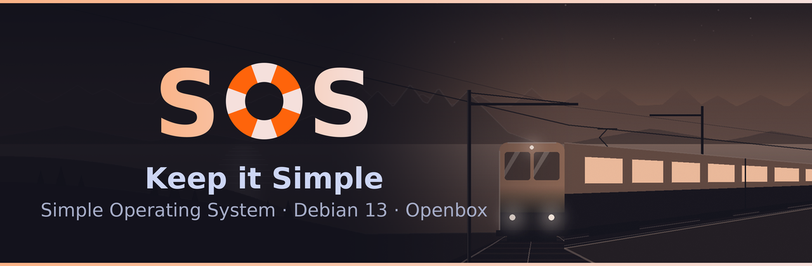
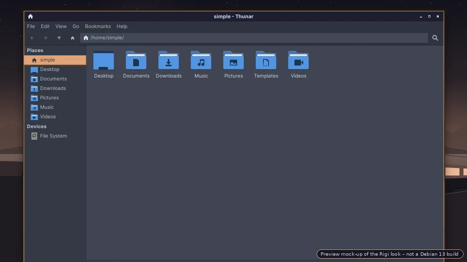
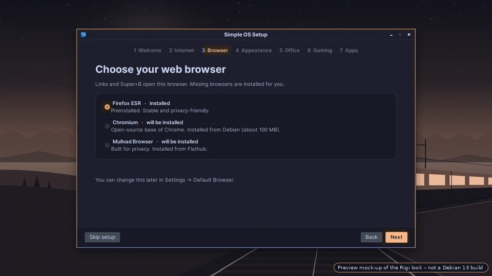
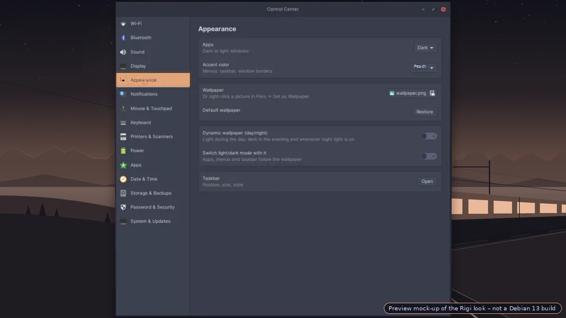
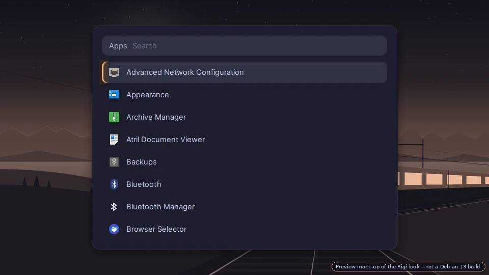

# Simple OS

> [!NOTE]
> **You are on the branch `trixie`: work on Simple OS 2.0 "Rigi", based on Debian 13 "trixie".** The texts here
> already describe 2.0 as planned; the code is still being moved over from Debian 12, and there is no 2.0 ISO yet
> (first preview planned for Q1 2027). The current release is **1.2** (Debian 12): download the
> [latest release](https://github.com/FreakySneaky787/Simple-OS/releases/latest) or read the README on
> [`main`](https://github.com/FreakySneaky787/Simple-OS/tree/main). Plan and timeline: [ROADMAP.md](ROADMAP.md#20-rigi--debian-13-trixie),
> issues #50–#53. (Remove this note when 2.0 is released.)

**A fast, calm Linux desktop based on Debian 13. It sets itself up, updates itself, and you never need a terminal.**

  <a href="https://github.com/FreakySneaky787/Simple-OS/releases/latest"><b>⬇ Download Simple OS (latest release, about 1.5 GB)</b></a>
  &nbsp;·&nbsp; <a href="RELEASE_NOTES.md#known-issues">Known issues</a>
  &nbsp;·&nbsp; <a href="https://github.com/FreakySneaky787/Simple-OS/discussions">Questions</a>
  &nbsp;·&nbsp; <a href="https://github.com/FreakySneaky787/Simple-OS/issues/new/choose">Report a bug</a>

> [!WARNING]
> **The pictures below are a preview ("show") of the planned Rigi look, not real 2.0 screenshots.** They are
> edited screenshots of Simple OS 1.x (Debian 12): peach accent color and the new wallpaper added by hand. **A real
> Debian 13 port does not exist yet** (issue #50); real screenshots replace these once the first 2.0 preview ISO is out.

| | |
|---|---|
|  The desktop |  Setup Wizard on the first login |
|  Control Center |  App menu |

## System requirements

- 64-bit PC (x86-64) with **UEFI or legacy BIOS**. **Secure Boot is supported**, so you can leave it on.
- 2 GB RAM (1 GB minimum for the installer, 4 GB or more recommended for browsing and gaming)
- 20 GB disk space (the installer accepts 10 GB)
- Internet for the setup wizard (browser, office suite, games) and for updates

Which computers Simple OS is known to work on, what didn't work, and how to add yours:
[hardware compatibility](docs/HARDWARE.md).

## Install

1. **Download** `Simple-OS.iso` and `Simple-OS.iso.sha256` from the [latest release](https://github.com/FreakySneaky787/Simple-OS/releases/latest).
2. **Check the download** (optional, recommended):
   - Linux: `sha256sum -c Simple-OS.iso.sha256` should print `Simple-OS.iso: OK`
   - Windows (PowerShell): `Get-FileHash Simple-OS.iso` and compare the hash with the one in `Simple-OS.iso.sha256`
3. **Make a USB stick** (4 GB or larger, everything on it is erased):
   - Windows / macOS / Linux: [balenaEtcher](https://etcher.balena.io) – pick the ISO, pick the stick, Flash.
   - Windows: [Rufus](https://rufus.ie) also works. If it asks, choose **"Write in DD Image mode"**.
   - Linux: *Disks* (gnome-disks) → select the stick → *Restore Disk Image…*, or
     `sudo dd if=Simple-OS.iso of=/dev/sdX bs=4M status=progress oflag=sync` (replace `sdX` with the stick – check with `lsblk`!)
4. **Start from the stick.** Usually F12, F9, F2 or Esc right after power-on, depending on the brand. The live
   session needs no password. If something unexpected asks: user `simple`, password `live`.
5. **Install** with **Install Simple OS** on the desktop.

Already running Simple OS? New versions arrive through **Software Updates** – no need to reinstall. From 1.x
(Debian 12) to 2.0 (Debian 13) a guided upgrade with a restore point is planned (issue #52).

## Testing Simple OS

Thank you for testing! Every report helps, especially from real hardware.

**Wanted for 2.0 "Rigi"** (once the first preview ISO is out – planned for Q1 2027, announced in
[Discussions](https://github.com/FreakySneaky787/Simple-OS/discussions)):

- **Installing the preview on real hardware**, in **legacy BIOS / MBR** mode as well as **UEFI**, with **Secure Boot**
  on, and next to Windows: does everything that worked with 1.x still work on Debian 13?
- **Graphics, Wi-Fi, sound, sleep** on your computer – especially **NVIDIA** (new driver version) and very new or
  very old laptops.
- **Upgrading a 1.x system to 2.0** (only on a computer where nothing can be lost, with a backup): do your files,
  apps and settings come along?
- **Your apps from the Software Store** (Flatpak) and Steam games after the upgrade.

Until then, the current release is 1.2 – reports about it are just as welcome.

**How to report:**

1. Open **Menu → Help → Report a Problem**. It saves a report file to your Desktop (your name, user name, network
   names and addresses are removed).
2. Open a [bug report](https://github.com/FreakySneaky787/Simple-OS/issues/new/choose), fill in the form and drag the
   report file into it.
3. Useful extra logs, if something went wrong:
   - errors of the current start: `journalctl -b -p err`
   - errors of the previous start (e.g. after a hang at shutdown): `journalctl -b -1 -p err`
   - an install that did not finish (still in the live session): `sudo cat /root/.cache/calamares/session.log`

Not sure if it's a bug, or a question like "does it run on my PC?" – ask in [Discussions](https://github.com/FreakySneaky787/Simple-OS/discussions).

## Thanks

Thanks to all Testers & Users <3

Every test on real hardware, every bug report and every idea makes Simple OS better.

## Documentation

- [Hardware compatibility](docs/HARDWARE.md) – which computers Simple OS runs on, and how to add yours
- [Release notes](RELEASE_NOTES.md) – what is new, known issues
- [Roadmap](ROADMAP.md) – what comes next (2.0 "Rigi" on Debian 13)
- [Contributing](CONTRIBUTING.md) – reporting bugs, ideas, pull requests
- [For developers](docs/DEVELOPING.md) – building the ISO, updates and one-time steps, how we work, the structure
- [The tools](docs/TOOLS.md) – what each of Simple OS's own tools does
- [Maintaining](docs/MAINTAINING.md) – releasing a new version · [Testing checklist](TESTING.md) · [Security](SECURITY.md)

## License

Simple OS's own files are licensed under the [GPL-3.0](LICENSE); the Debian packages in the image keep their own licenses.
